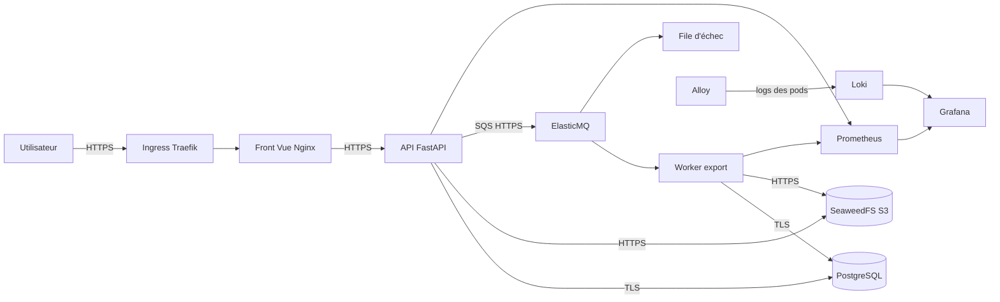
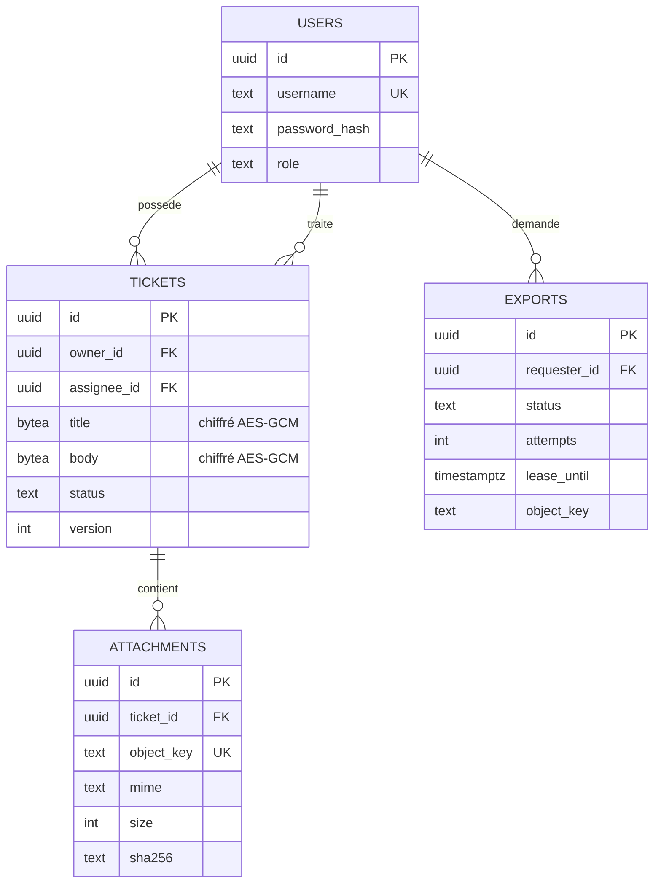
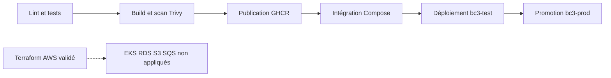

# Rapport BC3 — Support bancaire cloud-native

Thomas Gassmann — RNCP40875, bloc 3 — travail individuel — 23 novembre 2026

Version PDF (13 pages) : [rapport-bc3-thomas-gassmann.pdf](../output/pdf/rapport-bc3-thomas-gassmann.pdf).

## Besoin

Une petite équipe plateforme doit déployer et exploiter une application web à trois niveaux. Domaine retenu : le support client d’une banque. Un client ouvre un ticket et joint un justificatif PDF ou PNG ; un agent fait évoluer le statut ; chacun peut demander un export CSV de ses tickets, produit en tâche de fond. Le contexte bancaire justifie un niveau de confidentialité élevé sans alourdir le métier. Le domaine doit encore être validé par l’enseignant.

| Source | Exigences |
|---|---|
| Sujet BC3 | Front, back sans état, base relationnelle, stockage objet, file + worker ; images optimisées et publiées, Compose ; Kubernetes (HPA, résilience, stockage persistant) ; CI/CD sur push, Terraform reproductible ; métriques, logs, dashboards, alerte, SLI/SLO ; sécurité rattachée à ISO 27001 ; coût chiffré et deux optimisations mesurées ; dépôt Git et rapport de 10 à 15 pages |
| Référentiel C6.1–C8.2 | Stockage et traitement cloud, sécurité, KPI et coûts, CI/CD, MLOps (C7.4), supervision et IaC. C6.1 à C6.4 demandent aussi une certification de fournisseur cloud, hors de ce projet |
| Ajout du projet | Suggestion d’intention entraînée sur BANKING77, pour couvrir C7.4 (MLOps) |

## Architecture

| Composant | Rôle | Choix et alternative |
|---|---|---|
| Front Vue + Nginx | Interface servie séparément de l’API | — |
| API FastAPI | Logique métier, authentification ; sans état (sessions en base), donc plusieurs réplicas possibles | Django écarté : ORM et back-office inutiles ici |
| PostgreSQL | Données métier, sessions, verrouillage des jobs | — |
| SeaweedFS (S3) | Pièces jointes et sauvegardes | Compte AWS réel écarté faute de budget ; même protocole que S3, sans sa durabilité |
| ElasticMQ (SQS) + worker | Exports asynchrones | RabbitMQ écarté : SQS garde le même client qu’en cible AWS |
| Prometheus, Grafana, Loki | Métriques, tableaux de bord, alertes, logs | — |

Modèle de données :

Les tables techniques `sessions`, `audit` et `schema_migrations` complètent le schéma. Le titre et le texte des tickets sont chiffrés ; identifiants, statuts et dates restent en clair pour permettre les requêtes.

## Traitement asynchrone

Une demande d’export est d’abord enregistrée en base, puis annoncée dans la file. Le worker prend le job avec un verrou (`FOR UPDATE SKIP LOCKED`) et un bail de 60 s : deux workers ne traitent jamais le même job, et un message reçu deux fois ne produit pas de second export. Après trois échecs, le job passe en `failed` et le message en [file d’échec](dictionnaire.md#file-déchec). Si la file est indisponible, le worker retrouve les jobs en attente dans la base.

## Kubernetes et résilience

Cluster [kind](dictionnaire.md#kind) à deux nœuds : Deployments, Services, [Ingress](dictionnaire.md#ingress), ConfigMaps, Secrets, PVC, requests/limits, [HPA](dictionnaire.md#hpa) et PDB. Déploiement en [rolling update](dictionnaire.md#rolling-update) sans perte de capacité (`maxUnavailable=0`) ; canary et blue/green, facultatifs, n’apportaient pas assez sur un seul hôte.

| Essai (version 1.2.1, 250 s de charge) | Résultat |
|---|---|
| Requêtes réussies | 4 660 sur 4 660 |
| Latence p95 | 74 ms |
| HPA | 1 → 3 réplicas |
| Reprise après suppression d’un pod | 10,2 s (scrutation toutes les 10 s environ) |
| Configuration invalide | Rejetée, puis rollback et rolling réussis |

Le 23 novembre, le cluster a été recréé de zéro par l’étape de déploiement : 32 tests réussis dans le cluster et sauvegarde/restauration vérifiée. Preuves : `docs/evidence/k8s/`.

## CI/CD et infrastructure

Chaque job GitHub Actions appelle un script de `scripts/ci/`, et la chaîne locale `scripts/ci_local.sh` rejoue les mêmes scripts. Les pull requests exécutent lint, tests, build et scan ; la publication et le déploiement ne se font que sur push vers `main`. actionlint ne relève aucune erreur et les étapes de déploiement et de promotion ont tourné localement. **Le workflow n’a jamais été exécuté sur GitHub et les images ne sont pas publiées sur [GHCR](dictionnaire.md#ghcr).**

[Terraform](dictionnaire.md#terraform) AWS décrit VPC, EKS, RDS Multi-AZ chiffré, S3, SQS et file d’échec, KMS, IAM et ECR ; validé et testé avec un provider simulé, jamais appliqué. La reconstruction locale passe par `terraform_data`, qui appelle le script de reconstruction (cluster, secrets et volumes neufs, 17 tests). Arbitrage : des providers `kind` et `kubernetes` ont été écartés, car `kubernetes_manifest` doit joindre le cluster dès le `plan`, et le chargement des images comme le chiffrement d’etcd exigeraient de toute façon des commandes shell.

## Supervision

| Élément | Mise en œuvre |
|---|---|
| Métriques | Prometheus en HTTPS : API et worker |
| Dashboard | Grafana : disponibilité, p95, débit, âge des exports, résultats, CPU, logs |
| Logs | [Loki](dictionnaire.md#loki) + Alloy, lecture des logs des pods par l’API Kubernetes ; source Grafana vérifiée |
| Alerte | `APIUnavailable` : déclenchée 31 s après l’arrêt volontaire de l’API, résolue 47 s après la remise en service |
| [SLO](dictionnaire.md#sli-et-slo) | Disponibilité ≥ 99 % et p95 < 500 ms, atteints sur la fenêtre de charge mesurée |
| Sauvegarde | Dump chiffré en stockage objet, restauré dans une base neuve, 7 tables comparées |

Pas de traces distribuées (facultatives dans le sujet).

## Sécurité et ISO 27001

| Mesure | Contrôle | Mise en œuvre et preuve |
|---|---|---|
| Chiffrement | A.8.24 | TLS partout (API, base, S3, file, supervision) ; [AES-GCM](dictionnaire.md#aes-gcm) pour tickets, pièces jointes et sauvegardes ; Secrets chiffrés dans etcd |
| Moindre privilège | A.5.15, A.8.2, A.8.3 | Rôle SQL sans droits d’administration, identités S3 séparées, [RBAC](dictionnaire.md#rbac) : le compte applicatif ne lit pas les Secrets |
| Authentification | A.8.5 | [Argon2id](dictionnaire.md#argon2id), sessions hachées, cookie sécurisé, [CSRF](dictionnaire.md#csrf), contrôle d’origine, limitation des échecs |
| Secrets | A.5.17, A.8.12 | Générés hors dépôt, absents des images et de l’archive |
| Journalisation | A.8.15 | Table d’audit SQL ; logs centralisés dans Loki |
| Supervision | A.8.16 | Prometheus, Grafana, alerte testée |
| Sauvegarde | A.8.13 | Restauration réelle vérifiée |
| Configuration par le code | A.8.9 | Terraform, manifests générés |
| Séparation des environnements | A.8.31 | `bc3-prod` : mêmes images que `bc3-test`, secrets distincts ; [NetworkPolicy](dictionnaire.md#networkpolicy) vérifiée (trafic depuis `bc3-test` bloqué, connexion ouverte sans la règle) — `docs/evidence/environments/` |
| Sécurité de la chaîne | A.8.25, A.8.28, A.8.7 | Lint, tests, audits de dépendances, [Trivy](dictionnaire.md#trivy) bloquant les vulnérabilités corrigeables |

Reste ouvert : 47 avis HIGH sans correctif par image API/worker et 106 dans l’image de sauvegarde, à trier avant toute production ; durées de conservation proposées mais non approuvées. Il s’agit d’une correspondance pédagogique, pas d’une certification ISO.

## FinOps

| Optimisation | Avant | Après |
|---|---|---|
| Sondes Kubernetes natives au lieu de lancer Python | 0,403 cœur, 232 Mo, 3 réplicas au repos | 0,007 cœur, 75 Mo, 1 réplica |
| Image worker dédiée | 759 Mo | 276 Mo (−64 %) |

Coût estimé de la cible AWS (Paris, 730 h par mois, prix publics) : 251 USD par mois, 327 USD avec 30 % de marge. Arbitrage : un seul NAT, moins cher mais moins disponible. Aucune facture réelle ; énergie et CO₂ non mesurés. Preuves : `docs/evidence/finops/`.

## MLOps

Modèle TF-IDF + LinearSVC entraîné sur BANKING77 (77 intentions en anglais, licence CC BY 4.0) : accuracy 88,3 %, F1 macro 0,883, top 3 96,1 % sur le test officiel. Promotion automatique seulement si le F1 de validation dépasse 0,75 et ne recule pas de plus de 0,02 ; rollback servi par une vraie inférence de l’ancienne version ; refus d’un modèle dégradé ou altéré. La suggestion est une aide à confirmer par un agent.

## Difficultés et corrections

| Difficulté | Correction |
|---|---|
| PostgreSQL neuf sans base (socket attendu absent) | Volume dédié sur `/var/run/postgresql` |
| Variable `S3_PORT` injectée par Kubernetes | Service Links désactivés |
| Latence p95 de 680 ms (400 lectures de clé par réponse) | Une lecture par réponse : p95 74 ms |
| Sauvegarde incohérente (écriture après le dump) | Dump et contrôles sur le même snapshot |
| Cluster kind disparu de Docker (23 novembre) | Recréé de zéro par la CI locale ; données internes de l’ancien cluster perdues |

## Correspondance RNCP

| Compétence | Réalisation | Statut |
|---|---|---|
| C6.1 Stockage | PostgreSQL, objet chiffré, PVC ; réplication cloud préparée | Vérifié localement ; réplication cloud non vérifiée |
| C6.2 Traitement | API, worker, file, export | Vérifié |
| C6.3 Sécurité des données | Chiffrement, accès, logs ; conservation proposée | Vérifié ; conservation à approuver |
| C6.4 Performance et coûts | SLO mesurés, deux optimisations, coût chiffré | Vérifié localement |
| C6.1–C6.4 | Certification de fournisseur cloud | À réaliser par le candidat |
| C7.1 Conteneurs et orchestration | Images multi-stage, Compose, Kubernetes | Vérifié |
| C7.2 CI/CD | Pipeline découpé, tests automatisés | Vérifié localement ; run GitHub absent |
| C7.3 Automatisation des flux | Exports asynchrones, contrôles de qualité | Vérifié ; revue de gouvernance absente |
| C7.4 MLOps | Versions, promotion, rollback du modèle | Vérifié |
| C8.1 Supervision et résilience | Prometheus, Grafana, Loki, alerte, HPA, pannes | Vérifié |
| C8.2 IaC | Terraform AWS validé, reconstruction locale | Vérifié localement ; pas d’apply AWS |

## Limites

| Limite | Conséquence |
|---|---|
| Aucun déploiement cloud | AWS décrit et testé hors ligne seulement |
| Workflow GitHub jamais exécuté | Publication des images et CD non démontrées à distance |
| Un seul hôte | Pas de haute disponibilité physique |
| Avis HIGH sans correctif | Triage nécessaire avant production |

## Usage de l’IA dans la réalisation

J’ai utilisé des assistants d’IA générative (Codex, puis Claude pour la relecture finale) pour la réécriture des textes, la recherche et le sourçage des références et la génération des documents. Les chiffres cités proviennent des exécutions du projet et renvoient à des fichiers de preuve ; j’assume le contenu et sa présentation.
